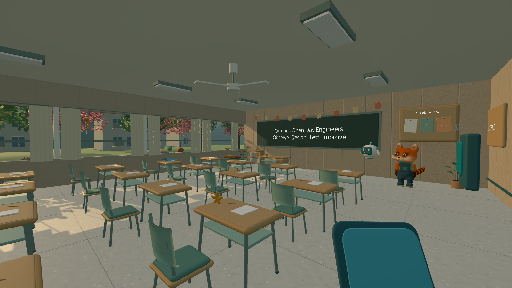
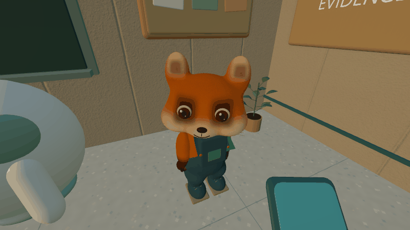
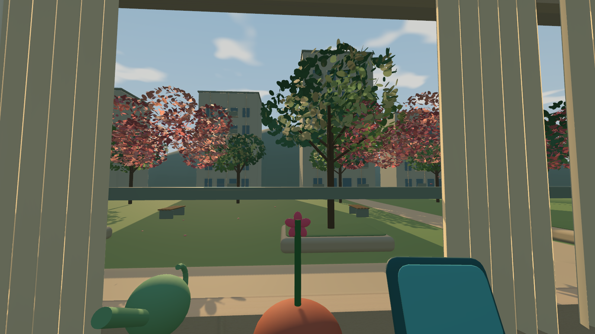
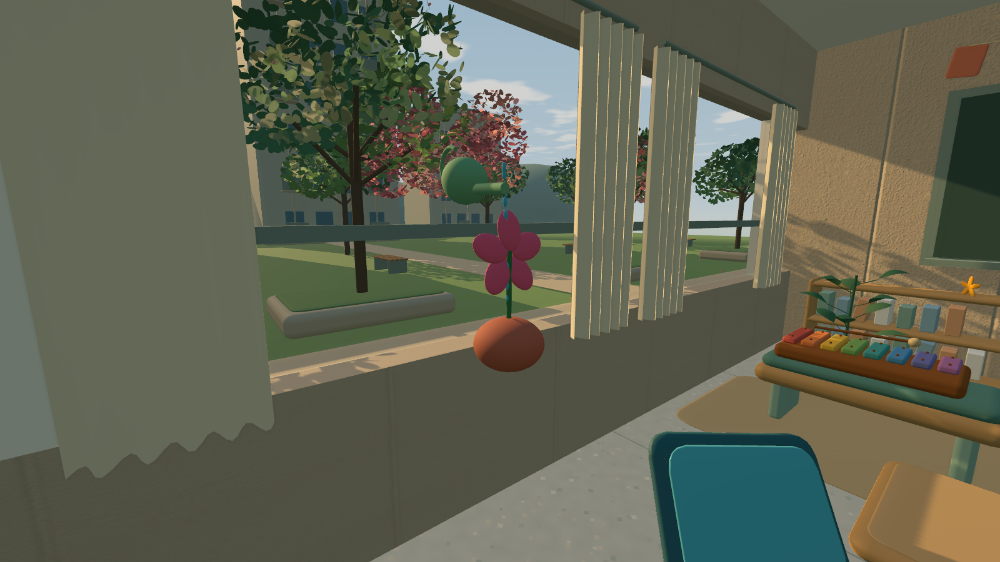
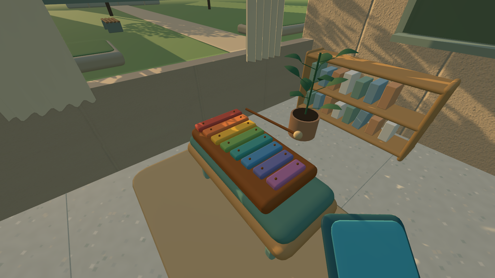
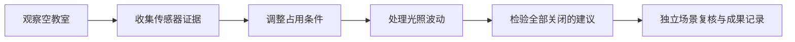

# 校园工程师 · Campus Engineer

**走进香港校园，用观察、实验和反例，修好一间“没人却还在耗电”的教室。**

[English](README.en.md) · [试玩与操作](docs/PLAY_GUIDE.md) · [设计与学习流程](docs/DESIGN.md) · [技术结构](docs/ARCHITECTURE.md) · [开发计划](docs/ROADMAP.md) · [验证记录](docs/VALIDATION.md)

面向中小学学习场景的第一人称 STEAM 游戏样章。玩家在温暖的校园里调查传感器、调整控制规则，再用实验结果判断方案是否合理。学习任务之外，也可以扔纸飞机、敲木琴、照顾窗边的小花，和小浣熊向导互动。

项目以香港教育应用为方向，正在探索“学生愿意玩，老师能看懂学习过程”的产品形式。目前是个人开发原型，使用 AI 辅助开发与部分原创插画生成，尚未完成学校试点或商业化验证。

| 当前状态 | 内容 |
| --- | --- |
| 版本 | 0.3 开发样章 / Windows 优先 |
| 引擎 | Unity 2022.3 LTS、C#，参考版本 2022.3.46f1c1 |
| 语言 | 简体中文、繁體中文、English，199 条本地化文字 |
| 学习任务 | 3 段控制规则挑战、反例检验、独立场景复核 |
| 课间探索 | 纸飞机、8 音木琴、浇花、风铃、3 个纸星星，共 7 项可保存发现 |
| AI 状态 | 离线预设提示；在线 LLM 与任意 Python 执行尚未接入 |

## 实机展示

以下为公开源码版在此次 Unity 验证中重新捕获的真实三维画面，不是概念图。

| 小浣熊回应动作 | 窗外校园景色 |
| --- | --- |
|  |  |
| 浇花互动 | 音乐角 |
|  |  |

开始界面、教室画框及桌面图标包含 AI 生成的原创插画，与上面的三维实机画面分别呈现。当前画面和角色仍会继续打磨。

## 可以做什么

- **从场景里找线索**：推开教室门，拿取数据板，检查占用、温度和光照传感器。
- **用实验修正规则**：处理“空教室仍运行”“光照波动导致反复切换”等问题。
- **判断建议是否可靠**：用“全部关闭”的反例，认识节能与使用需求之间的约束。
- **看见推理过程**：保存规则、实验轨迹和证据记录，支持本地成果导出。
- **在课间自由探索**：纸飞机连续飞行、琴键回弹、浇水开花、风铃和隐藏星星。
- **按自己习惯操作**：第一人称移动与固定视点点击模式可切换，提供视角和音量设置。

## 下载试玩

[下载 Windows 公开试玩版](https://github.com/syt1126/campus-engineer/blob/main/downloads/CampusEngineer-Windows-v0.3-public.zip)。完整解压后打开 `CampusEngineer.exe`，无需安装 Unity。此为开发预览版。

## 快速运行

1. 安装 Unity 2022.3 LTS；原开发环境为 `2022.3.46f1c1`。
2. 克隆本仓库，用 Unity Hub 打开仓库根目录。
3. 打开 `Assets/Campus/Scenes/SmartClassroom.unity`，点击 Play。
4. 编辑场景看起来为空是正常现象：`CampusGame.Bootstrap()` 在运行时创建校园。

公开源码保留完整的原创教学逻辑、校园生成、向导和互动。Unity Asset Store 的 School assets 原始模型未公开打包，缺少它们时会略过相关装饰；恢复方法见[素材说明](docs/ASSETS.md)。

需要 Windows 程序时，在 Unity 菜单选择 **Campus Engineer → Build Windows prototype**，输出位于 `Builds/Windows/`。必须保留整个输出文件夹，不能只复制 `.exe`。

| 操作 | 按键 |
| --- | --- |
| 移动 / 观察 | WASD / 鼠标 |
| 与物件互动 | E；固定视点模式可直接点击 |
| 暂停 / 设置 / 语言 | Esc |
| 工程记录 | Tab |
| 提示 | R |
| 课间发现手账 | J |

## 学习任务怎么推进

课间探索始终是可选内容，不作为通关学习任务的前置条件。当前 Python 内容是规则卡对应的示例，不是自由代码编辑器或 Python 解释器。

## 开发与验证

- 原本地 0.3 构建完成了 46 项 Unity 集成检查；最终 Windows 程序补查了三语切换、新游戏、暂停、保存和正常退出。
- 公开版剔除受限制素材后，重新通过 **46 项 Unity 集成检查**和 **15 项模拟器断言**，详见[验证记录](docs/VALIDATION.md)。
- 纯 C# 模拟器提供 15 项规则、边界、单位换算和确定性断言；GitHub Actions 运行模拟器及公开文件检查，不冒充 Unity 全流程验证。
- `Tools/sculpt_campus_companion.py` 可重新生成向导网格，需要 Python 和 NumPy；正常运行已包含的网格不需要 Python。

## 接下来做什么

优先继续提高角色表现、动画自然度和课堂可用性，然后安排真实学生试玩与教师反馈。在线 AI 提示需要先设计学习边界、内容约束和教师控制；Steam 发行属于后续目标。详见[路线图](docs/ROADMAP.md)。

## 素材与使用范围

仓库是公开的项目展示源码，尚未为原创代码授予 MIT 等通用开源许可。第三方素材各自的许可仍然有效，详见 [LICENSE.md](LICENSE.md) 和[素材来源](docs/ASSETS.md)。请勿将截图中的第三方素材或源码资源视为可任意转售的素材合集。

欢迎通过 [Issues](../../issues) 反馈可复现问题，或按[贡献说明](CONTRIBUTING.md)讨论改动。
