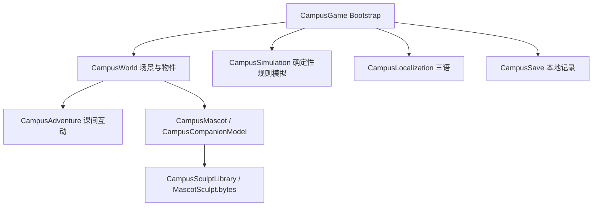

# 技术结构

## 运行结构



- `Assets/Campus/Scripts/CampusGame.cs`：启动、第一人称输入、界面、规则实验、存档。
- `CampusSimulation.cs`：纯 C# 教学模拟，无 Unity 渲染依赖；规则、传感器帧、实验结果与能耗统计。
- `CampusWorld.cs` / `CampusScenery.cs`：教室、灯光、校园外景与可选道具。
- `CampusAdventure.cs`：飞机轨迹、浇水、琴键、风铃和可保存发现。
- `CampusMascot.cs` / `CampusCompanionModel.cs`：角色装配与回应动作。
- `CampusSculptLibrary.cs`：加载预生成连续网格并创建毛发、衣物材质。
- `CampusLocalization.cs` / `Resources/CampusLanguages.json`：三语词条与选项持久化。
- `Assets/Campus/Editor/`：场景准备、Windows 构建、集成验证与角色预览。

## 数据与依赖

依赖 Unity 内置模块。模拟器输出保存在本地 JSON；运行期没有在线模型调用、账号服务或任意代码执行。贴图与网格通过 Resources 加载，可选授权道具缺少时跳过。

生成好的向导资源已包含在源码中。只有需要重新生成造型时才使用 Python + NumPy：

```bash
python Tools/sculpt_campus_companion.py
```

## 验证命令

纯逻辑测试（.NET 8 SDK）：

```bash
dotnet run --project Tests/SimulationChecks.csproj --configuration Release
python Tools/check_publication.py
```

Unity 菜单 **Campus Engineer → Run integration check** 运行带场景的检查，会临时操作游戏进度和语言选项；请在开发副本运行。

命令行也可通过 Unity `-batchmode -projectPath <repository> -executeMethod CampusEngineer.Editor.CampusValidation.Begin -logFile <local-log>` 启动；不要加 `-quit`，检查结束会自行退出。图形输出、授权与平台差异需在自己的环境验证。
